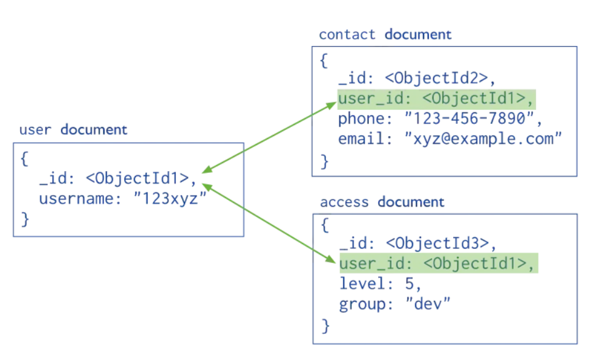

# UnaHur - Red Anti-Social - 2026 - C2 - TP2 (MongoDB)

Se solicita el modelado y desarrollo del backend de una red social llamada **“UnaHur Anti-Social Net”**, inspirada en plataformas populares donde los usuarios publican contenido y reciben comentarios sobre él.

# Continuidad con el TP1

Este trabajo es la **segunda etapa** del mismo producto. En el TP1 construyeron la API sobre una base de datos relacional con Sequelize. Ahora los sponsors decidieron **migrar la persistencia a MongoDB**, una base de datos **documental**.

- El **dominio es el mismo**: mismas entidades, mismas reglas de negocio y mismos requerimientos funcionales.
- Pueden (y se recomienda) **partir del código de su TP1**. Lo que cambia es la capa de persistencia y todo lo que dependa de ella.
- La API debería **mantener el mismo contrato** que en el TP1 (rutas, cuerpos de request y formato de respuestas), de modo que quien la consume no note el cambio. Si algo tiene que cambiar (por ejemplo, el formato de los identificadores), documéntenlo en el README y en el Swagger.

# Contexto del Proyecto

Los requerimientos del **MVP (Producto Mínimo Viable)** siguen siendo los mismos. Lo que sigue es lo que pidieron los sponsors: **cómo resolverlo es decisión del equipo**.

- Un usuario registrado puede hacer publicaciones. Toda publicación tiene **obligatoriamente una descripción** y, opcionalmente, **una o más imágenes**. Las imágenes se pueden agregar o quitar después de publicado el post.
- Las publicaciones pueden recibir **comentarios** de otros usuarios.
- Las publicaciones pueden tener **etiquetas (tags)**, y una misma etiqueta puede aparecer en muchas publicaciones.
- Los **comentarios con más de X meses de antigüedad no deben mostrarse** al consultar un post. X tiene que ser configurable sin tocar el código. Si un comentario está visible o no **no se guarda en la base**: se calcula a partir de su fecha (por ejemplo, con un **virtual** de Mongoose o filtrando en la consulta).

# Entidades

Los sponsors usan estos nombres para hablar del dominio. Respetenlos en el modelo:

- **User**: usuario registrado. Se identifica por su `nickName`, que no se puede repetir.
- **Post**: publicación que hace un usuario en una fecha determinada.
- **Post_Images**: imágenes asociadas a un post. Para el MVP alcanza con guardar la **URL** de la imagen.
- **Comment**: comentario de un usuario sobre un post, hecho en una fecha determinada.
- **Tag**: etiqueta que se le puede asignar a un post.

Los atributos, las relaciones y las restricciones las definen ustedes a partir de los requerimientos. Tienen que poder justificar cada decisión.

# Modelado documental

Este es el cambio central respecto del TP1. En una base documental no hay tablas intermedias ni claves foráneas: cada relación se resuelve **embebiendo** documentos o **referenciándolos** por su `_id`. Queda a su criterio qué estrategia usar en cada caso, pero tienen que **justificarla** en el README (cómo se consulta, cómo crece, qué pasa al modificar o borrar).

Algunas preguntas que deberían poder responder:

- ¿Las imágenes de un post conviene embeberlas en el post o guardarlas en su propia colección?
- ¿Y los comentarios? Tengan en cuenta que un post puede acumular muchos y que hay que filtrarlos por fecha.
- ¿Cómo representan la relación muchos a muchos entre Post y Tag?
- Al borrar un post o un usuario, ¿qué pasa con sus comentarios, imágenes y etiquetas?

### Ejemplo de relación referenciada

# Stack obligatorio

- **Node.js** con **Express**.
- Base de datos **MongoDB**, accedida **exclusivamente con Mongoose** (schemas y modelos). No se acepta persistencia en memoria o en archivos.
- Validación de los datos de entrada con **Joi**, aplicada a través de **middlewares** de Express.

# Qué se espera

- Un **diagrama del modelo documental** que muestre las colecciones, sus campos, qué está embebido y qué está referenciado (equivalente al DER del TP1).
- Una **API REST** que permita operar sobre todas las entidades y sobre las relaciones entre ellas (por ejemplo: agregar o quitar imágenes de un post, asociar etiquetas a una publicación).
- **Validaciones** que garanticen la integridad de los datos:
  - Que no entren datos inválidos (schemas de Joi en middlewares).
  - Que las relaciones sean consistentes. MongoDB **no controla la integridad referencial**, así que es responsabilidad de la aplicación: por ejemplo, no comentar un post que no existe ni asociar un tag inexistente. Esto incluye responder bien ante un `id` con formato inválido.
  - Que el `nickName` sea único (índice único en el schema).
  - Ante un error, la API tiene que responder con un código HTTP adecuado y un mensaje claro.
- **Controladores con una única responsabilidad**: las validaciones de datos y de existencia van en los middlewares, no repetidas dentro de los controladores.
- Que el **puerto**, la **cadena de conexión a MongoDB** y demás parámetros (incluido el de los X meses) se configuren mediante **variables de entorno**. Tiene que poder apuntarse a otra instancia de MongoDB (local, Docker o Atlas) sin modificar el código.
- Un **README** con las instrucciones para levantar el proyecto desde cero, incluyendo cómo levantar o conectarse a MongoDB, y la justificación del modelo (embebido vs. referenciado).

# Documentación y pruebas

Igual que en el TP1, pero **actualizadas** al nuevo proyecto:

- **Swagger / OpenAPI**: la API tiene que estar documentada con una especificación en formato **YAML** que cubra **todos** los endpoints, con sus parámetros, cuerpos de request, respuestas y códigos de error. La documentación tiene que poder consultarse desde el propio servidor.
- **Colecciones de prueba**: entregar una colección (Postman, Insomnia, Bruno, Thunder Client o la herramienta que elijan) que permita probar todos los endpoints, incluyendo casos de error. Si mantuvieron el contrato del TP1, la colección anterior debería servir casi sin cambios: aprovéchenlo para comprobarlo.

# Bonus

Los bonus **no se ven en clase**. Requieren investigar por su cuenta más allá de lo pedido para el MVP.

1. Permitir subir las imágenes de un post al servidor y guardarlas en una carpeta del servidor web, en lugar de recibir solo la URL.
2. ¿Cómo modelarían que un usuario pueda **seguir** a otros y a su vez ser seguido por muchos (followers)? Implementarlo y comparar la solución con la que usarían en un modelo relacional.
3. La información de los posts no varía muy seguido. ¿Qué estrategias podrían usar para que no sea consultada constantemente desde la base de datos? Implementar alguna (por ejemplo, una caché con Redis).
