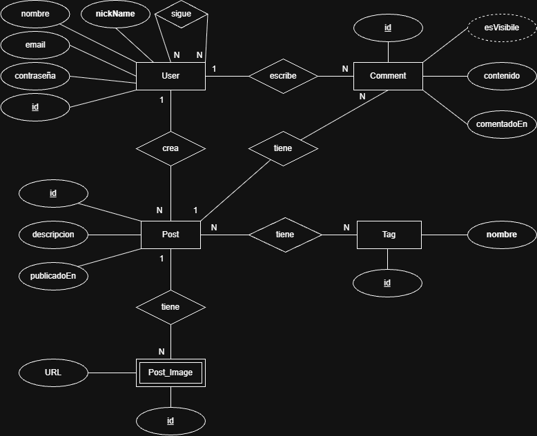
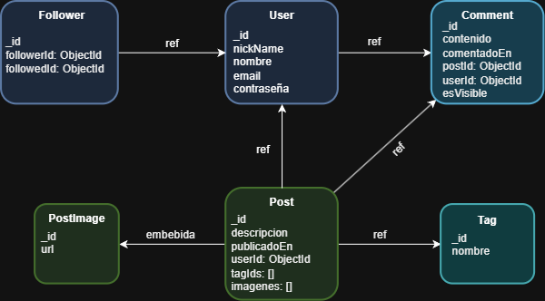

# UnaHur - Red Anti-Social (MongoDB) 🖳
UnaHur Anti-Social Net es una API REST desarrollada como trabajo práctico para la materia **Estrategias de Persistencia** de la **Universidad Nacional de Hurlingham**.

Este proyecto corresponde a la segunda etapa del desarrollo de la red social iniciado en el TP1. En esta versión se migró la capa de persistencia de una base de datos relacional (SQLite con Sequelize) a una base de datos NoSQL orientada a documentos (MongoDB), utilizando Mongoose.

Se mantienen las entidades, las reglas de negocio y las funcionalidades principales del sistema, adaptando el modelo de datos a una estructura documental.

## Instalación y Ejecución ⚙
Para clonar y ejecutar el proyecto:
Node.js, npm y Docker Desktop deben estar instalados para su funcionamiento.

**1. Clonar el repositorio**

    git clone https://gitea.unahur.edu.ar/Estrategia-de-persistencia-C2-2026/trabajo-practico-2-las-persistentes
    cd trabajo-practico-2-las-persistentes
    code .
**2. Instalar las dependencias**

    npm install
**3. Levantar los servicios con Docker Compose**

    docker compose up -d

Esto inicia los siguientes servicios:
| Servicio | Dirección |
| :--- | :--- |
| MongoDB | localhost:27017 |
| Mongo Express | http://localhost:8081 |
| Redis | localhost:6379 |

Mongo Express permite visualizar y administrar gráficamente las bases de datos y sus colecciones.

**4. Iniciar el servidor**

    npm run dev
Si el servidor inicia correctamente, la API estará disponible en: **http://localhost:3000**.

La aplicación se conecta a MongoDB y Redis antes de comenzar a escuchar peticiones.

---

## Ejecución de Pruebas Paso a Paso
El proyecto utiliza **cross-env** para aislar el entorno de ejecución (`NODE_ENV=test`) de modo que las pruebas impacten únicamente en la base de datos de test (`persistentes_redsocial_test`) y no sobre la de desarrollo. La ejecución de las colecciones de Postman se realiza mediante **Newman**.

Para realizar las pruebas correctamente, se deben utilizar **dos terminales** simultáneamente:

### Paso 1: Levantar el servidor en entorno de test (Primera Terminal)
1. Abrir la primera terminal en la raíz del proyecto.
2. Iniciar el servidor en modo de pruebas ejecutando:
   ```bash
   npm run start:test
   ```
3. Verificar que la consola indique que el servidor se encuentra activo y escuchando (por defecto en http://localhost:3000). La terminal debe dejarse abierta miestras se corren las pruebas.

### Paso 2: Ejecutar las pruebas (Segunda Terminal)
1. Abrir la segunda terminal ubicada en la raíz del proyecto.
2. Verificar que todas las dependencias están  instaladas (si es la primera vez que ejecuta el pryecto hay que correr **npm i** ).
3. Ejecutar el comando correspondiente a la colección de pruebas que se quiere  testear:

   - Para testear Usuarios:
     ```bash
     npm run test:users
     ```
   - Para testear Etiquetas:
     ```bash
     npm run test:tags
     ```
   - Para testear Posteos:
     ```bash
     npm run test:posts
     ```
   - Para testear Comentarios:
     ```bash
     npm run test:comms
     ```
   - Para testear Followers:
     ```bash
     npm run test:followers
     ```
4. Opcional, se pueden ejecutar todos los tests juntos con el comando:

     ```bash
     npm run test:all
     ```

---

## Stack Tecnológico ⌨


- **Node.js**: Entorno de ejecución para JavaScript.

- **Express.js**: Framework para el desarrollo del servidor y gestión de rutas.

- **MongoDB** & **Mongoose**: Base de datos documental NoSQL y ODM para el modelado, validación de schemas e índices.

- **Docker** & **Docker Compose**: Orquestación de contenedores para MongoDB, Mongo Express y Redis.

- **Joi**: Validación de schemas y datos de entrada mediante middlewares.

- **Multer**: Procesamiento y gestión de carga de archivos de imágenes.

- **Redis**: Capa de almacenamiento en caché para optimizar la consulta de publicaciones.

- **Swagger**: Documentación interactiva de la API (OpenAPI YAML).

- **Newman** & **Postman**: Automatización y ejecución de colecciones de pruebas.

---

## DER


## Diagrama del Modelo Documental 🗎


## Justificación del Modelo Documental
Durante la migración a MongoDB se evaluó cada entidad para decidir si convenía almacenar sus datos mediante documentos embebidos o referencias a otros documentos utilizando ObjectId.

**1. User**

    Colección independiente.

    El usuario conserva los atributos principales del dominio: nickName, nombre, email, fotoPerfil y contraseña. Mongoose genera automáticamente el campo _id.

    El nickName y el email poseen restricciones de unicidad mediante índices únicos, evitando la creación de usuarios con identificadores o correos electrónicos repetidos.

    La foto de perfil contiene su propia URL y puede representar tanto un archivo almacenado localmente en el servidor como una dirección externa.

    Las publicaciones, comentarios y relaciones de seguimiento se almacenan en colecciones independientes y se vinculan mediante referencias. De esta manera se evita que el documento del usuario crezca indefinidamente a medida que aumenta su actividad dentro de la red social.

**2. Post**

    Colección independiente.

    Cada publicación contiene los siguientes campos:

    descripcion: descripción de la publicación.

    publicadoEn: fecha de publicación.

    userId: referencia al usuario que creó la publicación.

    tagIds: array de referencias a etiquetas.

    imagenes: array de subdocumentos embebidos.

    Se utiliza una referencia hacia User porque un usuario puede crear múltiples publicaciones. A su vez, las etiquetas se vinculan mediante un array de ObjectId, permitiendo establecer una relación muchos a muchos entre publicaciones y etiquetas.

**3. PostImage**

    SubDocumento embebido dentro de Post.

    Las imágenes se almacenan como subdocumentos dentro de la publicación a la que pertenecen, sin utilizar una colección independiente.

    Se eligió esta estrategia porque una imagen no tiene sentido dentro del dominio sin su publicación asociada y normalmente se consulta y administra junto con ella.

    Cada subdocumento contiene su propia URL y puede representar tanto un archivo almacenado localmente en el servidor como una dirección externa.

    Esta decisión simplifica las operaciones de lectura y actualización, y permite que las modificaciones de las imágenes formen parte de las operaciones atómicas sobre el documento de la publicación.

**4. Comment**

    Colección independiente.

    Cada comentario contiene:

    contenido: texto del comentario.

    comentadoEn: fecha de creación.

    userId: referencia al usuario que escribió el comentario.

    postId: referencia a la publicación comentada.

    Los comentarios se almacenan por separado porque una publicación puede recibir una cantidad indeterminada de ellos. Embebirlos podría generar documentos demasiado grandes y dificultar las consultas y el filtrado por fecha.

    La visibilidad de los comentarios se determina mediante la variable de entorno COMMENT_MAX_MONTHS. Las consultas recuperan únicamente los comentarios cuya fecha se encuentra dentro del período permitido.

    Además, el modelo define un virtual llamado esVisible, que permite calcular dinámicamente esa condición sin almacenar un atributo adicional en MongoDB.

**5. Tag**

    Colección independiente.

    Cada etiqueta posee su propio _id y el atributo nombre, que tiene una restricción de unicidad.

    Las publicaciones almacenan las referencias a las etiquetas mediante el array tagIds.

    Esta estrategia permite reutilizar una misma etiqueta en distintas publicaciones sin duplicar sus datos y facilita la administración de las etiquetas de manera independiente.

**6. Follower**

    Colección independiente.

    Cada documento representa una relación de seguimiento entre dos usuarios:

    followerId: usuario que inicia el seguimiento.

    followedId: usuario que recibe el seguimiento.

    Se utiliza una colección independiente en lugar de almacenar arrays de seguidores y seguidos dentro de User, evitando que los documentos crezcan indefinidamente a medida que aumenta la cantidad de relaciones.

    Además, se define un índice compuesto único sobre followerId y followedId, que impide que un usuario siga más de una vez al mismo usuario.

---

### Eliminaciones ⚠︎
MongoDB no elimina automáticamente los documentos relacionados mediante referencias. Por eso, la aplicación debe implementar las operaciones necesarias para mantener la integridad de los datos.

- **Al eliminar una publicación**: se eliminan los comentarios asociados. Las imágenes embebidas desaparecen junto con el documento de la publicación. Los archivos físicos asociados también se eliminan del servidor.

- **Al eliminar un usuario**: se eliminan sus publicaciones, sus comentarios y sus relaciones de seguimiento. También se eliminan los archivos físicos correspondientes a sus publicaciones.

- **Al eliminar una etiqueta**: se quitan sus referencias de las publicaciones asociadas antes de eliminar el documento de la etiqueta.

- **Al dejar de seguir a otro usuario**: se elimina el documento que representa esa relación de seguimiento.

Estas operaciones se realizan desde la lógica de la aplicación, ya que las referencias entre colecciones no generan eliminaciones en cascada automáticamente.

---

## Refactorización de PostImage y Cambios en el Contrato de la API ☕︎
En el TP1, la gestión de imágenes de las publicaciones se realizaba a través de endpoints independientes (`/postImages`). En esta migración a MongoDB, se decidió **eliminar la colección y las rutas independientes de PostImage**, adoptando una estrategia de **incrustación (embedding) pura**. 

Dado que una imagen no tiene sentido en nuestro dominio sin su publicación asociada y siempre se consultan juntas, las imágenes ahora son un array de subdocumentos embebidos dentro de `Post`. Esto garantiza la atomicidad en las operaciones de lectura y actualización y permite modificar las imágenes junto con el documento padre.

**Impacto en la API:**
Los endpoints `POST /postImages` y `DELETE /postImages/:id` fueron eliminados. La adición y eliminación de imágenes ahora se orquesta exclusivamente a través de la actualización parcial del documento padre en el endpoint `PATCH /posts/:id`, enviando los campos `nuevaImagenUrl` o `eliminarImagenId` en el cuerpo de la petición.

## Manejo de Imágenes (Híbrido: Local y URLs) 🗁
La API permite adjuntar imágenes a las publicaciones mediante dos modalidades:
1. **Archivos Físicos (Multer):** Se suben a través de `form-data` y se almacenan localmente en el servidor (`src/public/uploads`), guardando su ruta relativa en la base de datos.
2. **URLs Externas:** Se pueden enviar enlaces de internet en texto plano (`imagenesUrls` o `imagenes`), los cuales se guardan directamente como subdocumentos dentro del array de imágenes del post.

Multer permite recibir hasta cinco archivos por petición en el campo imagenes y realiza una validación de los tipos de archivo permitidos.

> **Nota de limpieza:** Tanto en la actualización (`PATCH`) como en la eliminación (`DELETE`) de un post, el sistema cuenta con un middleware de limpieza automática (`fs.unlinkSync`) que remueve del disco físico los archivos locales asociados para evitar acumular basura en la carpeta `uploads`.

---

## Caché con Redis ⌨

Se utiliza `Redis` para optimizar la consulta del listado de publicaciones.

Cuando se realiza una petición `GET /posts`, el sistema verifica si existe la clave posts:all en Redis.

Si la información está almacenada, se devuelve directamente desde la caché. 

Si no existe, se consulta MongoDB, se recuperan las publicaciones con sus usuarios y etiquetas mediante populate() y se almacena el resultado en Redis durante 60 segundos.

Cuando se crean, modifican o eliminan publicaciones, se invalida la clave correspondiente para evitar devolver información desactualizada.

La aplicación también contempla la invalidación de la caché cuando se modifican o eliminan usuarios y etiquetas que forman parte de las publicaciones.

---

## Uso de Redis
El proyecto utiliza Redis para almacenar temporalmente las publicaciones obtenidas desde MongoDB. Esto permite responder más rápidamente a las consultas posteriores, evitando realizar la misma búsqueda en la base de datos en cada petición.

La caché de publicaciones se almacena bajo la clave posts:all y tiene un tiempo de expiración de 60 segundos.

### 1. Iniciar los servicios

Antes de ejecutar el backend, asegurarse de que Docker Desktop esté abierto.

Desde la terminal, ubicarse en la carpeta raíz del proyecto (donde se encuentra compose.yaml) y ejecutar:

    docker compose up -d

Este comando inicia los contenedores de MongoDB, Mongo Express y Redis.

Para comprobar que estén funcionando:

    docker ps

Entre los contenedores activos debe aparecer redis_unahur_ciu.

### 2. Iniciar el backend

En otra terminal, ejecutar:

    npm run dev

Una vez iniciado el servidor, realizar una petición GET a:

    http://localhost:3000/posts

Esta petición permite que el backend consulte las publicaciones y almacene el resultado en Redis si todavía no existe una caché válida.

### 3. Consultar Redis desde la terminal

Para ingresar a la consola de Redis, ejecutar:

    docker exec -it redis_unahur_ciu redis-cli

Una vez dentro, se pueden utilizar los siguientes comandos:

| Comando | Función |
| :--- | :--- |
| KEYS * | Muestra las claves almacenadas. |
| GET posts:all | Muestra el contenido de la caché de publicaciones. |
| TTL posts:all | Consulta los segundos restantes antes de que expire la caché. |
| exit | Sale de la consola de Redis.|

**Importante**: La clave posts:all se genera cuando se realiza una consulta a GET /posts. Si transcurren 60 segundos, la caché expira y deberá generarse nuevamente con otra petición.

### 4. Detener los servicios

Cuando se termine de trabajar con el proyecto, se pueden detener los contenedores ejecutando:

    docker compose down

Este comando detiene y elimina los contenedores, pero conserva los datos almacenados en los volúmenes de Docker.

---

## Arquitectura del Proyecto 🛠

| Directorio | Responsabilidad |
| :--- | :--- |
| src/config/ | Configuración de base de datos y Redis |
| src/controllers/ | Lógica de las operaciones de cada endpoint |
| src/middlewares/ | Validación de peticiones, referencias y existencia de recursos. |
| src/models/ | Modelos y esquemas de Mongoose |
| src/routes/ | Definición de rutas y asociación con los controladores |
| src/schemas/ | Esquemas de validación de datos mediante Joi |
| src/uploads | Almacenamiento local de las imágenes subidas |
| src/tests/ | Colecciones y archivos de configuración para Newman/Postman |
| compose.yaml | Configuración de servicios (MongoDB, Mongo Express, Redis) |
| .env | Plantilla de variables de entorno |
| swagger.yaml | Especificación OpenAPI de la API |

---

## Documentación de la API ᯤ

La API cuenta con documentación interactiva desarrollada mediante Swagger UI, basada en la especificación OpenAPI definida en swagger.yaml.

Una vez iniciado el servidor, se puede acceder a la documentación desde: `http://localhost:3000/api-docs`

Allí se encuentran organizados los recursos y sus operaciones, junto con los parámetros, los datos de entrada y las respuestas esperadas.

### Los principales recursos de la API son:

**Users**: administración de usuarios.

**Followers**: gestión de relaciones de seguimiento.

**Posts**: creación, consulta, modificación y eliminación de publicaciones.

**Tags**: administración de etiquetas.

**Comments**: creación, consulta, modificación y eliminación de comentarios.

---

## Endpoints de la API 🗁
Las rutas se agrupan por entidad para facilitar su utilización y mantenimiento.

| Recurso | Prefijo |
| :--- | :--- |
| Usuarios | /users |
| Etiquetas | /tags |
| Comentarios | /comments |
| Publicaciones | /posts |

---

## Sobre el grupo 🌐︎
Proyecto desarrollado por el grupo **Las Persistentes** de la Comisión 3.

API desarrollada para la materia **Estrategias de Persistencia** en la **Universidad Nacional de Hurlingham**.

### ☰ Integrantes:
* Fogel, Facundo
* González Ortiz, Celeste Alejandra
* Laginestra, Elisa
* Fajardo, Eugenia
